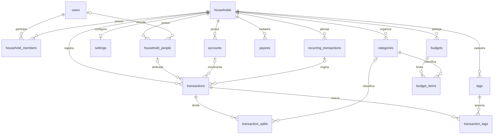

# Banco de dados

Atualizacao 2026-10-26: 16 tabelas; migration 0001 adiciona sessions.

Inventario do schema em `apps/api/src/db/schema.ts`, referencia `5bbbb44`.
A migration inicial esta em `apps/api/drizzle/0000_lazy_mantis.sql`, com snapshot
e journal em `drizzle/meta`. Esses arquivos fazem parte do Git.

## Convencoes

- SQLite local via `better-sqlite3`, com `PRAGMA foreign_keys = ON` na conexao da API.
- Propriedades TypeScript em camelCase e colunas SQL em snake_case.
- IDs em `text`, gerados na aplicacao por `randomUUID()`; sem default de ID no SQL.
- Dinheiro em `integer` representando centavos; R$ 120,50 corresponde a `12050`.
- Flags booleanas usam `integer` com conversao do Drizzle.
- Datas de negocio sao `text`, com formato esperado `YYYY-MM-DD`.
- `createdAt` e `updatedAt` sao obrigatorios, com default SQL `CURRENT_TIMESTAMP`.
  Isso gera texto UTC `YYYY-MM-DD HH:MM:SS`. Atualizacoes dos services usam
  `new Date().toISOString()`, portanto os formatos de timestamp ainda diferem.
- Defaults nao atualizam `updatedAt` automaticamente. Services devem preencher
  esse campo; nao existem triggers de atualizacao.
- Enums declarados em `text({ enum: [...] })` ajudam a tipagem; a migration atual
  nao tem CHECKs para restringir esses valores no banco.

Neste inventario, `?` significa nullable. Exceto `transaction_tags`, todas as
tabelas possuem `id` como chave primaria textual e `createdAt`/`updatedAt`.
Campos sem `?` sao NOT NULL. Os limites de entrada da API estao nos schemas Zod,
nao necessariamente em constraints SQL.

## Identidade e familia

| Tabela | Campos de negocio | Constraints e observacoes |
| --- | --- | --- |
| `users` | `name`, `email`, `passwordHash?`, `avatarUrl?`, `isActive=true` | Email unico; nullable para usuarios legados ainda nao provisionados |
| `households` | `name` | Nome nao e unico; representa uma casa/grupo financeiro |
| `household_members` | `householdId`, `userId`, `role` | Par casa/usuario unico; role: owner, admin, member |
| `household_people` | `householdId`, `userId?`, `name`, `color?`, `avatarUrl?`, `isActive=true` | Vinculo opcional com login; nao ha unique de casa/usuario nem exigencia SQL de membership |
| `settings` | `householdId`, `currency=BRL`, `timezone=America/Sao_Paulo`, `locale=pt-BR`, `monthlyPeriodStartDay=1`, `includePendingInReports=true` | Household unico: no maximo uma configuracao por casa |

`household_members` controla o modelo de acesso futuro; `household_people`
controla a atribuicao de receitas/despesas. Criar uma pessoa financeira nao
deveria conceder acesso. Os endpoints de people aceitam userId apenas para administradores da casa,
exigem membership correspondente e impedem vinculo duplicado na mesma casa.

## Sessoes

A tabela sessions possui id (SHA-256 do token aleatorio), userId e householdId
com FK/cascade, csrfToken, expiresAt ISO UTC, createdAt e updatedAt. Indices
por user e expiracao. O token original existe apenas no cookie HttpOnly.
A membership e revalidada em cada acesso; sua remocao bloqueia a sessao mesmo
sem FK composta. A migration 0001 so cria essa tabela e indices.

## Cadastros financeiros

| Tabela | Campos de negocio | Constraints e observacoes |
| --- | --- | --- |
| `accounts` | `householdId`, `personId?`, `name`, `type`, `institution?`, `currency=BRL`, `initialBalanceCents=0`, `currentBalanceCents=0`, `creditLimitCents?`, `statementClosingDay?`, `statementDueDay?`, `isShared=false`, `isArchived=false` | Tipos: checking, savings, cash, credit_card, investment, loan, other |
| `categories` | `householdId`, `parentId?`, `name`, `type`, `color?`, `icon?`, `isSystem=false`, `isArchived=false` | Unique casa/tipo/nome; tipos: income, expense, transfer; parent referencia categories |
| `payees` | `householdId`, `name`, `normalizedName` | Unique casa/nome normalizado; representa favorecido ou pagador |
| `tags` | `householdId`, `name`, `color?` | Unique casa/nome; marcadores independentes de categoria |

`currentBalanceCents` e um saldo persistido, atualizado pelos services de
transacoes. O endpoint de recalculo usa saldo inicial + movimentos confirmados
nao excluidos. A API rejeita saldo atual informado pelo cliente; alterar saldo
inicial recalcula o atual atomicamente. As somas usam BigInt internamente, mas
as colunas/DTOs continuam em centavos inteiros seguros JavaScript. A mudanca
nao altera o schema SQL e nao exige migration. Dados legados nao sao regravados
na inicializacao. Moeda de conta com historico nao pode mudar.

Os campos de cartao sao preparacao para funcionalidades futuras. Nao existem
tabelas de fatura, fechamento efetivo, parcelas ou pagamento de fatura.

## Lancamentos

| Tabela | Campos de negocio | Constraints e observacoes |
| --- | --- | --- |
| `transactions` | `householdId`, `personId?`, `accountId?`, `payeeId?`, `type`, `status=confirmed`, `amountCents`, `description?`, `notes?`, `transactionDate`, `competenceDate?`, `transferAccountId?`, `linkedTransactionId?`, `isRecurring=false`, `recurringTransactionId?`, `createdByUserId?`, `deletedAt?` | Tipos: income, expense, transfer, adjustment; status: pending, confirmed, canceled |
| `transaction_splits` | `transactionId`, `categoryId?`, `amountCents`, `description?` | Uma ou mais partes por transacao; soma validada na API |
| `transaction_tags` | `transactionId`, `tagId` | PK composta; sem id proprio e sem timestamps |

Transferencia usa um unico registro: `accountId` e origem e
`transferAccountId` e destino. Nao criar dois lancamentos independentes para o
mesmo movimento. `linkedTransactionId` esta no schema, mas o CRUD nao o utiliza.

`createdByUserId` foi reservado para autoria de quem lancou, diferente da pessoa
responsavel. A API o preenche com a identidade autenticada, preservando a autoria ao editar.
Os campos de recorrencia tambem nao sao alimentados pelo CRUD atual.

## Planejamento ainda sem endpoints

| Tabela | Campos de negocio | Constraints e observacoes |
| --- | --- | --- |
| `recurring_transactions` | `householdId`, `personId?`, `accountId?`, `categoryId?`, `payeeId?`, `type`, `amountCents`, `description?`, `frequency`, `interval=1`, `dayOfMonth?`, `dayOfWeek?`, `startsAt`, `endsAt?`, `nextRunAt?`, `autoCreate=false`, `isActive=true` | Frequency: daily, weekly, monthly, yearly; nao ha agendador |
| `budgets` | `householdId`, `personId?`, `name`, `period`, `startsAt`, `endsAt?` | Period: monthly, yearly, custom |
| `budget_items` | `budgetId`, `categoryId`, `limitCents` | Unique orcamento/categoria |

Recorrencias ainda nao suportam conta destino para transferencia, splits ou
tags no template. Antes de ativar geracao automatica, completar o contrato,
definir idempotencia e regras de datas, como recorrencia no dia 31.

## Relacionamentos e exclusao

O diagrama resume as relacoes; nao exibe todos os campos opcionais ou a segunda
relacao de conta para transferencias.

- FKs para household usam cascade. Nao existe endpoint para apagar uma casa.
- Membership referencia user com cascade; pessoa financeira referencia user com set null.
- Referencias opcionais a pessoa, conta, payee, categoria pai e recorrencia usam
  em geral set null; confira o schema antes de adicionar exclusao fisica.
- Splits e vinculos de tags usam cascade ao excluir fisicamente a transacao.
- Budget items usam cascade para budget e category.
- O CRUD preserva historico via archive/soft delete, mesmo quando o SQL permitiria
  exclusao fisica. Payees e tags em uso sao protegidos na aplicacao.

## Indices

- Users: unique email.
- Memberships: unique household/user e indice user.
- People: indices household e user.
- Settings: unique household.
- Accounts: indices household e person.
- Categories: unique household/type/name e indice household.
- Payees: unique household/normalizedName.
- Transactions: indice composto household/transactionDate e indices account,
  person, type e status.
- Splits: indices transaction e category.
- Tags: unique household/name; transaction_tags tem PK transaction/tag.
- Recorrencias: indices household e nextRunAt.
- Budgets: indices household e person; items unique budget/category.

FKs simples nao impedem vincular registros de casas diferentes. Os services
verificam diversos vinculos, mas o banco nao tem FKs compostas para esse isolamento.
Tambem nao ha constraints SQL de soma dos splits, valores positivos ou dias validos.

## Evolucao para PostgreSQL

Migrar apenas quando houver uma necessidade concreta. Caminho proposto:

1. Fazer backup consistente e definir uma janela sem escrita.
2. Adaptar schema Drizzle para pg-core e escolher driver PostgreSQL.
3. Gerar migrations proprias do novo dialeto; nao reutilizar o SQL SQLite.
4. Converter flags e padronizar datas/timestamps, defaults e constraints.
5. Transferir dados preservando IDs e ordem das FKs.
6. Comparar contagens, relacionamentos, soma dos splits e saldos por conta.
7. Testar CRUD, rollback, filtros e relatorios antes de trocar a conexao.

Esse procedimento e planejamento, ainda sem script ou teste de migracao.
